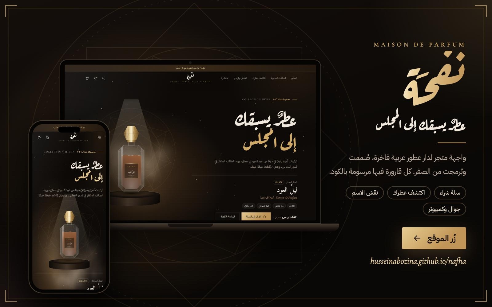

<div align="center">

# نَفْحَة

### NAFHA · MAISON DE PARFUM

**عطرٌ يسبقك إلى المجلس**

<a href="https://husseinabozina.github.io/nafha/"></a>


<br><br>

<a href="https://husseinabozina.github.io/nafha/"></a>

<sub>اضغط على الصورة لفتح الموقع · <a href="assets/Nafha-Showcase.pdf">ملف العرض PDF</a></sub>

</div>

---

<div dir="rtl">

## الفكرة

واجهة متجر لدار عطور عربية فاخرة، مبنية بالكامل من الصفر بلا قوالب ولا منصات جاهزة. تأخذ الصفحة شكل بوتيك ليلي: خلفية بلون خشب العود المدخّن، وذهبي بلون الزعفران، وكل عطر يُعرض كقطعة مضيئة في خزانة عرض.

لا توجد صورة واحدة في المشروع. كل قارورة مرسومة بالكود (SVG): شكل الزجاج وسماكته، ولون السائل، والغطاء الذهبي أو الخشبي أو الرخامي، وانعكاس الضوء عليه.

## المزايا

| | |
|---|---|
| **واجهة متحركة** | قارورة على قاعدة مضيئة، يتصاعد خلفها دخان بخور على Canvas، وتميل مع حركة الماوس، والسائل بداخلها يتموّج. ثلاثة عطور تتبدّل تلقائيًا ويتغيّر لون الإضاءة مع كل عطر. |
| **المجموعة** | عشرة عطور وأدهان، منها توله دهن العود الأسامي، مع تصفية حسب العائلة العطرية وترتيب حسب السعر أو الأحدث. |
| **العرض السريع** | الهرم العطري (افتتاحية، قلب، قاعدة)، ومؤشرات الثبات والفوحان والتركيز، واختيار الحجم والكمية. |
| **السلة** | تعديل الكميات، شريط تقدّم للشحن المجاني، اختيار عيّنة ٢ مل مجانية، وأسعار شاملة ضريبة القيمة المضافة ١٥٪. تُحفظ السلة والمفضلة في متصفح الزائر. |
| **اكتشف عطرك** | ثلاثة أسئلة عن التوقيت والأجواء وقوة الحضور، ثم ترشيح بنسبة تطابق مع بديلين. |
| **نقش الاسم** | معاينة حيّة للنص منقوشًا على زجاج القارورة أثناء الكتابة، بثلاثة خطوط (رقعة، نسخ، لاتيني) وصندوق هدية اختياري. |
| **طقوس الطبقات** | دليل التعطّر الخليجي (دهن ← بخور ← عطر) مع طقم مجمّع. |
| **من الحقل إلى القارورة** | مصادر المكوّنات بإحداثياتها ومواسمها: الطائف، ظفار، بورسات، آسام، خراسان، ميسور. |

## الهوية البصرية

| اللون | الرمز | الاستخدام |
|---|---|---|
|  | `#110C09` | خلفية بلون العود المدخّن |
|  | `#D9A85B` | ذهبي الزعفران |
|  | `#F2D196` | لمعة الذهب |
|  | `#F1E8DA` | العاج للنصوص |
|  | `#D27F8F` | ورد الطائف |

**الخطوط:** Aref Ruqaa للعناوين، وAmiri لأسماء العطور، وCormorant Garamond للنصوص اللاتينية، وIBM Plex Sans Arabic للنص الأساسي. كلها من Google Fonts.

## التقنية

- ملف واحد `index.html`: HTML وCSS وJavaScript خالص، دون أي مكتبة أو إطار عمل.
- القوارير مرسومة بـ SVG، ودخان البخور والجزيئات الذهبية على Canvas.
- يعمل على الجوال والكمبيوتر، ويحترم إعداد تقليل الحركة في نظام الزائر.
- النوافذ (العرض السريع، السلة، البحث، القائمة) مبنية على عنصر `<dialog>` مع دعم لوحة المفاتيح.

## التشغيل

لا يحتاج إلى تثبيت أو بناء. افتح `index.html` في المتصفح مباشرة، أو شغّل خادمًا محليًا:

</div>

```bash
npx serve .
```

<div dir="rtl">

## الخطوات القادمة

- [ ] ربط بوابة دفع (مدى، Apple Pay، تابي)
- [ ] لوحة تحكم لإدارة المنتجات والأسعار
- [ ] واجهة خلفية للطلبات وتأكيدها بالبريد
- [ ] نسخة إنجليزية

</div>

---

<details>
<summary><b>English</b></summary>

<br>

**Nafha** is a luxury Arabic perfume storefront built from scratch, with no templates and no e-commerce platform. It is designed as a night boutique: smoked-oud backgrounds, saffron gold, and every fragrance lit like an object in a display case.

There are no images in the project. Every bottle is drawn in code as SVG, including the glass thickness, the liquid color, the gold, wood or marble cap, and the light streaks on the glass.

**Features:** animated hero with canvas incense smoke and pointer-tilt bottle · 10 fragrances and oils with family filters and sorting · quick view with the olfactory pyramid and longevity/sillage meters · cart with free-shipping progress, a free 2 ml sample and VAT-inclusive prices (stored in the visitor's browser) · a three-question scent finder · live glass-engraving preview in three scripts · a Gulf layering ritual guide · ingredient origins with real coordinates and harvest seasons.

**Stack:** a single `index.html` with plain HTML, CSS and JavaScript, no dependencies. Fully responsive, RTL-first, and respects reduced-motion settings.

**Next:** payment gateway integration, a product dashboard, an orders backend, and an English version.

</details>

<div align="center">
<br>
<sub>© ٢٠٢٦ دار نفحة للعطور</sub>
</div>
